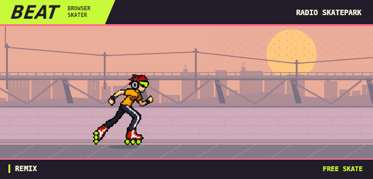

# Beat — Browser Skater

**Version 3.0.0** · [Install or update in Tampermonkey](https://raw.githubusercontent.com/slllky/universal-userscripts/main/companions/beat/Beat-Browser-Skater.user.js) · [Hear the station sampler](docs/beat-fm-sampler.mp3)

Open the bottom-left cassette and pick **Yo-Yo** under **Crew**. Set his duet partner to **Corn**, leave **Free skate** and **Auto combos in Free skate** on, and give them four seconds. Yo-Yo opens with a crossover while Corn answers with a toe manual. The pair trade parts until they finish the seven-step Yo-Yo Exchange. The live card shows the performers and current step.

## Skate

| Lead | Signature line |
|---|---|
| Beat | Needle Thread |
| Gum | Sugar Rush |
| Combo | Bass Drop |
| Yo-Yo | Yo-Yo Exchange |
| Corn | Kernel Panic |
| Zero Beat | Dead Channel |
| Poison Jam | Toxic Spill |

**Free Skate.** Each lead opens with their signature. After short cruising breaks, the crew works through all 15 routines before recycling the set. Five routines give two skaters different parts. Choose a duet partner, leave the deck on automatic to rotate through the other six, or skate solo. Reduced motion disables automatic routines and holds a pose during manual tricks.

**Tricks.** The book shows the steps for every routine. Thirteen new lines run seven to nine moves each, plus the original Sidewinder and Air mail. Try crossover, toe manual, rocket air, fishbrain grind, flatspin and wallride individually. Selecting a trick takes over from an automatic routine immediately. Click the lead to dance or right-click for the deck.

**Scoring.** Chain different manual tricks and collect spray cans to build a combo up to a 2× multiplier. Finishing a manual line awards a bonus. After four seconds without another link the score banks and your personal best is saved. Automatic lines are exhibitions.

**Cursor trail and tabs.** Draw a route for your lead to follow after a one-to-eight-second delay (four seconds by default). The trail holds up to 60 pickup cans. Beat follows the focused script-enabled tab. “Jump to another tab” cycles through open pages and holds a background destination for 45 seconds. The line, current step, partner and score can travel between tabs. Cursor paths stay local.

## Beat FM

The [19-second dial sampler](docs/beat-fm-sampler.mp3) recreates the hooks of Wisteria Underpass, Kerosene Laces, Peach Soda Static and Exit Through the Moonroof from the release’s note and synthesizer schedules.

Choose a track under **Radio** and press **Play radio**. Use the previous and next buttons to change tracks, or choose sequence, shuffle or repeat. The station synthesizes its music locally. The volume, selected track and playback order are saved. Leaving the tab silences playback.

| Track | Style | BPM |
|---|---|---:|
| Curbside Frequency | Big beat | 108 |
| Wisteria Underpass | Dusty hip-hop | 82 |
| Kerosene Laces | Jungle | 168 |
| Chrome Umbrella | Two-step garage | 132 |
| Pocket Full of Quarters | Arcade electro | 119 |
| Exit Through the Moonroof | Synthwave | 89 |
| Peach Soda Static | Future funk | 103 |
| Boiler Room Broadcast | Acid techno | 137 |
| Blue Hour at Platform Nine | Liquid halftime | 74 |
| Chalk Lines in Dub | Dub | 76 |
| Safety Pin Polaroid | Skate punk | 151 |
| Paper Lantern Express | Deep house | 124 |
| Quarterpipe Mirage | Desert trip-hop | 95 |
| Neon Serration | Grime | 146 |
| Last Train, First Light | Balearic house | 110 |

## Setup and installation

Open the install link at the top and confirm the update in Tampermonkey. Update the same script entry to retain previous settings and personal bests. Future versions use the native update URL. The script runs in top-level HTTP and HTTPS pages where userscripts are permitted. Its skater art, UI and music are self-contained.

Under **Setup** you can change speed, size, ground clearance, paint color, effects and motion. Beat’s Classic and Remix skins remain available. Other leads have their own sheets. Turn off **Clickable skater** to let page clicks pass through the lead.

For a standalone preview, download [Beat-Preview.html](Beat-Preview.html) and open it in a browser. The preview uses the release engine, crew, soundtrack and deck. Cross-tab travel uses userscript storage in the installed version.

Tab to the cassette and press Enter. Use the arrow keys to switch tabs and Escape to close. Enter or Space on the lead starts a dance, and Shift+F10 opens the controls. The cassette and Tampermonkey’s **Beat: controls / bring here** command stay available when the skater is hidden.

Run `node build.cjs` to rebuild the script, update metadata and preview. Run `npm ci` and `npm test` for the engine, soundtrack, tab, deck, native-rendering and packaged integration tests.

[Sprite sheets and credits](assets/README.md) · [Public art gallery](https://github.com/slllky/tampermonkey-art/tree/main/review/beat) · [Browser Companions](../README.md)
