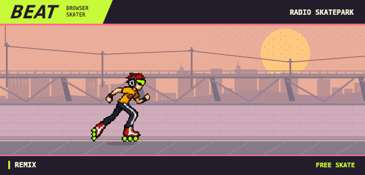

# Beat artwork

| Rider | Signature line | Cels | Files |
|---|---|---:|---|
| Beat | Needle Thread | 54 | [Sheet](remix/sheet.png) · [Frame map](remix/frames.json) · [Portrait](remix/portrait.png) |
| Gum | Sugar Rush | 16 | [Sheet](gum/sheet.png) · [Frame map](gum/frames.json) · [Portrait](gum/portrait.png) |
| Combo | Bass Drop | 16 | [Sheet](combo/sheet.png) · [Frame map](combo/frames.json) · [Portrait](combo/portrait.png) |
| Yo-Yo | Yo-Yo Exchange | 16 | [Sheet](yoyo/sheet.png) · [Frame map](yoyo/frames.json) · [Portrait](yoyo/portrait.png) |
| Corn | Kernel Panic | 16 | [Sheet](corn/sheet.png) · [Frame map](corn/frames.json) · [Portrait](corn/portrait.png) |
| Zero Beat | Dead Channel | 16 | [Sheet](zero/sheet.png) · [Frame map](zero/frames.json) · [Portrait](zero/portrait.png) |
| Poison Jam | Toxic Spill | 16 | [Sheet](poison/sheet.png) · [Frame map](poison/frames.json) · [Portrait](poison/portrait.png) |

The seven sheets use 128 × 128 transparent cells with the skate pivot at (64, 116). The first number pair in each cel’s bounds marks its upper-left corner. The last pair marks the exclusive bottom-right edge. The animation maps provide the playback order, including poses shared across actions.

The [street sheet](street/sheet.png) and [frame map](street/frames.json) contain Static Wax, Alleycat, Spool Skull and the spray-can pickup.

These generated fan-art sprites are in review. The characters and Jet Set Radio belong to SEGA. Corn wears his original blue outfit and cap. Poison Jam is represented by one blue, finned gang member. The [Classic Beat sheet](classic/sheet.png) preserves all 15 original cels credited to xugggys. Its [frame map](classic/frames.json) adapts them to the full move list.

[Public art gallery](https://github.com/slllky/tampermonkey-art/tree/main/review/beat)
