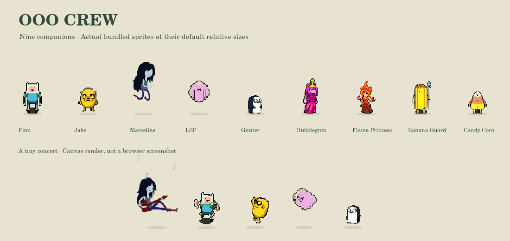

# Adventure Time — Ooo Crew

**Version 1.0.0** · A universal, self-contained companion crew for Tampermonkey.

Finn and Jake celebrate together. Marceline plays a tiny concert. Gunter makes off with Jake’s snack. Nine selectable companions share the bottom of your browser, with real sprite frames, individual activities, coordinated scenes, and a small illustrated field guide.

The default crew is **Finn, Jake, Marceline, Lumpy Space Princess, and Gunter**. Invite **Princess Bubblegum, Flame Princess, Banana Guard, and Candy Corn** from the guide. Everyone is available immediately.



*Actual canvas render of the crew; not a browser screenshot.*

## Install

1. Open [Adventure-Time-Ooo-Crew.user.js](Adventure-Time-Ooo-Crew.user.js), then choose **Raw** / **Download raw file**. For this private repository, sign into GitHub first.
2. Install in Tampermonkey. If the browser does not offer its install dialog, create a new userscript and paste in the complete file, or import the downloaded file.
3. Reload an ordinary HTTP or HTTPS webpage. The **OOO** button appears at the bottom left; the field guide opens once on first installation.

This is a separate userscript with its own namespace and saves. The original [Jake — Stretch Walker](../jake/) is unchanged. **Disable that standalone Jake entry if you only want one Jake on screen.**

Want to try it first? Download [Ooo-Crew-Preview.html](Ooo-Crew-Preview.html) and open it locally. It contains the actual script and all its art. Preview preferences are separate from Tampermonkey preferences.

## Play

| Control | What it does |
|---|---|
| OOO button / **Alt + Shift + O** | Open the field guide |
| Small pause button beside OOO | Freeze or resume the crew |
| **The crew** | Invite/remove individuals, choose a party preset, or trigger a character’s trick |
| **Adventures → Play mode** | Make the characters clickable; tap for a trick or drag to pick them up |
| **Drop snack** | Click one spot to place a snack; a free companion claims and eats it |
| **Gather here** | Click a meeting point and the crew assembles nearby |
| **Esc** | Cancel placement, release a dragged character, close the guide, and return to click-through browsing |
| **Hide crew** | Tuck everyone away; keep OOO available to wake them |
| **Snooze on this site** | Remember a pause for this hostname; reverse it through OOO or Tampermonkey’s menu |

Ordinary browsing is **click-through by default**. Play mode intercepts clicks only over the character hit targets. Snack/gather placement briefly uses the whole canvas until one click or Esc.

## Six coordinated scenes

| Scene | Required crew | What happens |
|---|---|---|
| Best-bud bump | Finn + Jake | They meet, hop toward one another, and celebrate |
| Tiny desk concert | Marceline + any friend | Marceline plays bass while up to four friends dance |
| The snack incident | Gunter + Jake | Gunter takes the snack and makes a getaway, with Jake following |
| Candy chemistry | Bubblegum + Flame Princess | They gather around a flask for a bubbling, fiery experiment |
| Lump royalty | LSP + Banana Guard | A tiny royal procession with a very enthusiastic princess |
| Campfire break | Any two friends | Up to six companions gather around a little fire |

Friends occasionally start scenes on their own. Only one coordinated scene owns the cast at a time. Removing a participant, dragging them, or changing the viewport releases the scene safely. Scenes unavailable to your current crew show which friends to invite.

Jake retains the original walker’s stretch construction: his face and feet stay intact while the middle elongates toward a nearby cursor. Each character also has a manual trick. Eight postcard stamps remember completed scenes, feeding, and picking someone up; they never gate features.

## Make it yours

- Four crew presets, individual invitations, and any combination of the nine companions.
- Treehouse, Candy Kingdom, and Nightosphere field guide covers.
- Companion size, walking speed, activity frequency, and distance above the bottom edge.
- Wandering, spontaneous scenes, and speech bubbles can be switched separately.
- Cartoon or Jarquin10 archive sprites for Marceline, with consistent art throughout her chosen set.
- Motion follows the device’s reduced-motion preference by default. Gentle mode disables autonomous wandering/group scenes and removes bouncing; explicit actions still work. Snacks are delivered directly to the nearest friend in gentle mode.
- Sound is off by default. An optional quiet, original eight-note synth phrase accompanies a concert after you enable sound. There are no voice recordings or show music.
- Preferences and postcards use Tampermonkey storage across websites. Open tabs receive preference changes where `GM_addValueChangeListener` is supported. Character positions and current scenes are per-tab, and play mode starts off on each page.

## Art and implementation

The userscript embeds **135 frames in 33 animation/pose sets**, plus the original Jake atlas. It makes no runtime asset requests, loads no external libraries or fonts, and reads no webpage text, forms, accounts, or browsing history. Site snoozes store only hostnames locally in the userscript’s settings.

The supplied art varies in detail and resolution. It is harmonized with transparent backgrounds, consistent scale/baselines, nearest-neighbor rendering, common shadows, and coordinated movement. Finn, Jake, Marceline, LSP, and Gunter have multi-frame cycles. Bubblegum, Flame Princess, Banana Guard, and Candy Corn have limited source poses, supplemented with movement and character-specific effects rather than fabricated extra sprite frames. The static Jake transformation collage is a reference, not a usable animation strip.

See [sprite sources and credits](assets/README.md). No blanket license is asserted over Adventure Time characters or third-party artwork.

## Build and checks

```sh
node build.cjs
npm ci
npm test
npm run test:render
```

Building needs only Node; the two development dependencies are for DOM and canvas checks. The preview and userscript are generated from the same `src/` and `assets/` inputs. The optional Python extraction tool documents how the supplied sheets were selected and cleaned; it is not needed for normal builds.

[TESTING.md](TESTING.md) records the checks and remaining limits. Live Tampermonkey/browser compatibility has not been verified. Browser-internal pages and extension-store restrictions remain outside ordinary universal matching.
