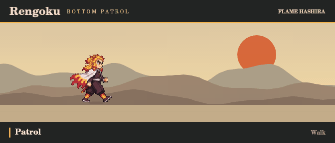

# Rengoku — Bottom Patrol

**2.0.0** turns the bottom of an ordinary webpage into a small night patrol. Rengoku walks, breaks into a run, vaults, braces, and fights eight demons. Each encounter has four hits, with different tells and reactions depending on the opponent.

[Install or update in Tampermonkey](https://raw.githubusercontent.com/slllky/universal-userscripts/main/companions/rengoku/Rengoku-Bottom-Patrol.user.js) · [Download the offline preview](Patrol-Preview.html) · [View the sprite sheets](https://github.com/slllky/tampermonkey-art/tree/main/review/rengoku)

Open the install link, choose **Update** if you have Bottom Patrol already, and reload a regular HTTP or HTTPS page. An existing hidden patrol stays hidden until you turn **Show patrol** back on. The flame crest remains available.

| Where | What you can do |
|---|---|
| Lower-left flame crest → **Patrol** | Set size, pace, height above the bottom, encounter frequency, flame effects, motion, and cursor interactions. The crest sits above the Ooo Crew launcher. |
| **Dojo → Encounter** | Pick a demon or let the patrol surprise you. Choose **Manual only** under Patrol to summon all encounters yourself. |
| **Dojo → Practice** | Try nine individual movements and three chained drills: Crescent vault, Cinder reversal, and Blazing relay. |
| On the page | Move your cursor near Rengoku to draw a swipe, click him for an action, or right-click him to summon a demon. Turn off interactions for click-through browsing. |

The cast includes Pink Demon, Lantern Eye, Furnace Brute, Dusk Stalker, Silk Moth, Temple Bell, Foxfire, and Basalt Oni. Watch the moth rise before a dive, the fox retreat before its double feint, and the bell rock back before its pulse.

The focused tab runs the patrol. It saves your settings across websites and passes its current encounter to the next focused tab. Gentle motion follows your device preference by default. It keeps encounters manual and uses held poses. All sprites ship inside the userscript. Tampermonkey can check the repository for later releases through its normal update controls.

## Build and verification

From this folder, run `node build.cjs` to rebuild the userscript and offline preview from the bundled art and source. Run `npm ci` and `npm test` for the development checks. See [asset credits](assets/README.md).

[Browser companions](../README.md) · [Userscript collection](../../README.md)
